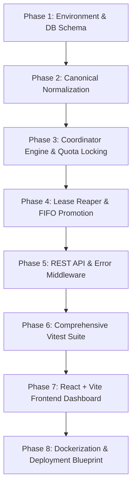

# Architectural Implementation Plan: Enrichment Lookup Coordinator

> **Document Status:** Complete / Implemented  
> **Author:** Vishal Shinde  
> **Date:** October 2026  
> **Project:** Enrichment Lookup Coordinator with Provider Quota Protection  

---

## 1. Executive Summary & Problem Understanding

### 1.1 Objective
Build an Enrichment Lookup Coordinator service that manages threat intelligence enrichment requests against a simulated upstream provider with strict daily rate limits. 

### 1.2 Core Constraints & Invariants
1. **Hard Daily Quota:** Default of 10 requests per UTC calendar day. Under no concurrency race condition must the provider ever be invoked more than 10 times in a day.
2. **Short-Lived Leases (5 minutes):** An approved request receives a temporary lease. If the analyst does not execute the lookup before lease expiry, the lease is revoked, and the reserved unit is recycled back to the pool.
3. **Queue & FIFO Promotion:** When the quota limit is reached (active leases + completed lookups = 10), incoming requests must enter a `QUEUED` state. When leases expire, the oldest eligible queued request must automatically be promoted to `LEASED`.
4. **Idempotency & Deduplication:** 
   - Identical idempotency keys must return the cached original response without consuming extra quota.
   - Different idempotency keys targeting the same active normalized indicator (`QUEUED` or `LEASED`) must be rejected with an active conflict error (`DUPLICATE_ACTIVE_INDICATOR`).
5. **Canonical Normalization:** Domains, IPv4 addresses, and URLs must be canonicalized so semantic duplicates (e.g. `HTTP://EVIL.COM:80/path/` vs `evil.com/path`) map to the exact same indicator.

---

## 2. Architecture & Design Decisions

### 2.1 Concurrency & Quota Protection Strategy
- **Decision:** Utilize **PostgreSQL ACID transactions** with pessimistic row-level locking (`SELECT ... FOR UPDATE`).
- **Why not In-Memory or Redis?**
  - In-memory counters fail on horizontal multi-replica scaling or server restarts.
  - Redis distributed locks introduce clock drift risks, distributed state split-brain, and dual-system synchronization failures.
  - PostgreSQL provides serializable atomicity directly on the database row representing today's quota period (`daily_quotas` table). By locking the row for the current date, all concurrent reservation attempts are serialized deterministically.
- **Formula Invariant:**
  $$\text{active\_leases} + \text{used\_units} \le \text{daily\_limit}$$

### 2.2 Database Schema Design
To guarantee consistency at the database level:
1. `daily_quotas`:
   - Primary key: `date DATE` (UTC calendar day).
   - Columns: `daily_limit INT`, `used_units INT`.
2. `enrichment_requests`:
   - Primary key: `id UUID`.
   - Columns: `idempotency_key`, `indicator_raw`, `indicator_normalized`, `indicator_type`, `status` (`QUEUED`, `LEASED`, `COMPLETED`, `EXPIRED`, `FAILED`), `threat_category`, `analyst_id`, `lease_expires_at`, `created_at`, `completed_at`.
   - **Partial Unique Index:** 
     ```sql
     CREATE UNIQUE INDEX idx_active_indicator 
     ON enrichment_requests (indicator_normalized) 
     WHERE status IN ('QUEUED', 'LEASED');
     ```
     This strictly forbids concurrent duplicate active lookups for the same indicator at the storage layer.
3. `idempotency_keys`:
   - Stores `(key, request_id, response_code, response_body, created_at)` to return bit-for-bit identical responses on retries without re-evaluating business logic.
4. `lookup_results`:
   - Stores raw provider verdicts (`MALICIOUS`, `SUSPICIOUS`, `CLEAN`, `UNKNOWN`) and metadata.

### 2.3 Lease Expiry & Background Reaper
- Implement a dual-protection mechanism:
  1. **Background Reaper Worker:** Runs periodically (every 3 seconds) executing an atomic reconciliation loop:
     ```sql
     -- 1. Expire stale leases
     UPDATE enrichment_requests 
     SET status = 'EXPIRED' 
     WHERE status = 'LEASED' AND lease_expires_at < NOW();
     
     -- 2. Promote oldest QUEUED in FIFO order if capacity permits
     SELECT id FROM enrichment_requests 
     WHERE status = 'QUEUED' 
     ORDER BY created_at ASC 
     LIMIT capacity FOR UPDATE SKIP LOCKED;
     ```
  2. **Lazy Expiry on Execution:** If an analyst attempts to execute a leased lookup whose timestamp has elapsed before the reaper processed it, the transaction detects `lease_expires_at < NOW()`, marks it `EXPIRED`, and rejects execution with HTTP 409 Conflict.

---

## 3. Implementation Roadmap



### Phase 1: Environment & Database Foundation
- Configure TypeScript (`tsconfig.json`), linting, and Node.js 22+ ESM project structure.
- Define environment schema with Zod (`PORT`, `DATABASE_URL`, `DAILY_QUOTA_LIMIT`, `LEASE_DURATION_SECONDS`, `REAPER_INTERVAL_MS`).
- Implement PostgreSQL connection pool with connection timeout, max connection limit, and SSL detection for cloud providers.
- Write transactional migration bootstrapper (`runMigrations()`) executing `schema.sql` idempotently on startup.
- Add zero-dependency embedded database fallback for local development convenience.

### Phase 2: Canonical Normalization & Threat Provider
- Write unit-tested indicator normalizer:
  - Trim whitespace and lowercase schemes/hostnames.
  - Strip default ports (`:80` for HTTP, `:443` for HTTPS).
  - Strip trailing slashes, fragments (`#hash`), and sort query parameters.
  - Categorize indicator type: `IP`, `DOMAIN`, or `URL`.
- Implement mock upstream threat intelligence provider with deterministic category heuristics:
  - C2 / malware indicators $\to$ `MALICIOUS`
  - Phishing / credential harvesting $\to$ `SUSPICIOUS`
  - Internal / corporate infrastructure $\to$ `CLEAN`
  - Fallback to deterministic SHA-256 hash modulo.

### Phase 3: Core Coordinator Engine & Quota Transactions
- Implement `LookupCoordinator`:
  - `createOrQueueRequest(indicator, idempotencyKey, threatCategory, analystId)`:
    1. Check `idempotency_keys` table for existing key.
    2. Normalize indicator and check `idx_active_indicator` conflicts.
    3. Lock today's `daily_quotas` row with `FOR UPDATE`.
    4. Calculate `available = daily_limit - used_units - active_leases`.
    5. If `available > 0`, allocate lease for 300 seconds and set status `LEASED`.
    6. If `available == 0`, insert with status `QUEUED`.
  - `executeLookup(requestId)`:
    1. Lock request row `FOR UPDATE`.
    2. Assert status is `LEASED` and `lease_expires_at > NOW()`.
    3. Call simulated upstream provider.
    4. Transition status to `COMPLETED`.
    5. Atomically increment `used_units` in `daily_quotas`.
    6. Write result to `lookup_results`.

### Phase 4: Lease Reaper & Queue Promotion
- Create `LeaseReaper` background daemon:
  - Runs in a non-overlapping loop (`isReaping` guard) at configurable intervals.
  - Identifies expired leases and reaps them inside a transaction.
  - Evaluates queue depth and available slots.
  - Promotes oldest `QUEUED` records to `LEASED` with fresh 300-second lease windows.
- Expose manual trigger endpoint (`POST /api/enrichments/reconcile`) for testing and operational administration.

### Phase 5: REST API & Unified Error Middleware
- Expose endpoints:
  - `POST /api/enrichments` (Reserve lease or enqueue)
  - `POST /api/enrichments/:id/execute` (Run enrichment lookup)
  - `GET /api/enrichments` (List recent enrichment requests)
  - `GET /api/quota` (5 telemetry metrics: limit, active leases, used units, available units, queued count)
  - `POST /api/enrichments/reconcile` (Manual reconciliation trigger)
  - `GET /health` (Container readiness & database liveness probe)
- Standardize RFC 7807 error responses:
  ```json
  {
    "error": {
      "message": "Human readable summary",
      "code": "ERROR_CODE",
      "data": {}
    }
  }
  ```

### Phase 6: Automated Testing Suite
- Setup Vitest with a real PostgreSQL test harness (ephemeral database per test run).
- Verify all 12 core business rules:
  1. Exactly 10 distinct requests obtain leases when quota is 10.
  2. 200+ concurrent requests never exceed 10 simultaneous reservations or 10 completed lookups.
  3. Replay with identical idempotency key returns cached original without consuming quota.
  4. Different idempotency keys for same active indicator reject with `DUPLICATE_ACTIVE_INDICATOR`.
  5. Overflow requests enter queue in strict FIFO order.
  6. Completing lookup consumes reserved unit permanently for that day.
  7. Expired leases reject execution even before the reaper worker runs.
  8. Expiry releases reservation and promotes oldest queued request.
  9. Concurrent reaper runs never double-release quota or duplicate promotions.
  10. Concurrent duplicate execution calls for same lease execute provider only once.
  11. Mid-flight database failure rolls back partial changes atomically.
  12. Midnight boundary requests cannot use the wrong quota period.

### Phase 7: React + TypeScript UI Dashboard
- Build modern SOC analyst dashboard with React 18, Vite, and Lucide icons:
  - Real-time quota metrics cards (Daily Limit, Active Leases, Used Units, Available Capacity, Queued Requests).
  - Telemetry progress bar with color thresholds (Green $\to$ Yellow $\to$ Red).
  - Submit enrichment request form with client-side normalization preview.
  - Active requests table with live countdown timers (`MM:SS`).
  - Action buttons: "Run Lookup" (for leased), "Reconcile Leases", "Pause/Live Auto-refresh".
  - Verdict badge display (`MALICIOUS`, `SUSPICIOUS`, `CLEAN`) with metadata inspection.

### Phase 8: Containerization & Cloud Deployment
- Multi-stage `Dockerfile`:
  - Stage 1: Build React frontend into static assets (`frontend/dist`).
  - Stage 2: Compile TypeScript backend into CommonJS/ESM (`dist/`).
  - Stage 3: Minimal Node.js 22 Alpine runtime serving API and static assets from single port (`3000`).
- `docker-compose.yml` bundling app container with official `postgres:16-alpine`.
- `render.yaml` Blueprint specification for 1-click cloud deployment with managed PostgreSQL.

---

## 4. Risk Analysis & Mitigation Matrix

| Potential Risk | Root Cause | Mitigation Strategy |
|---|---|---|
| **Quota Over-allocation** | High concurrency race conditions between lease reservation and execution. | Pessimistic `SELECT ... FOR UPDATE` row lock on `daily_quotas` inside all reserving transactions. |
| **Duplicate Active Scans** | Multiple analysts submitting the same URL simultaneously. | Partial PostgreSQL unique index on `indicator_normalized` where status is `QUEUED` or `LEASED`. |
| **Zombie Leases** | Analyst closes browser without executing lookup. | 300-second TTL backed by background Lease Reaper worker and lazy verification on execution attempt. |
| **Clock / Timezone Drift** | UTC midnight boundary issues with local server time. | All database dates calculated via `CURRENT_DATE AT TIME ZONE 'UTC'` and Node `pg` date parser set to literal `YYYY-MM-DD`. |
| **Connection Pool Exhaustion** | Spike of 200+ concurrent incoming requests. | Pool capped at 30 connections with queued acquisition, fast transactions, and indexing on lookups. |

---

## 5. Verification & Acceptance Criteria
- [x] All 29 unit, integration, and concurrency stress tests pass cleanly (`npm test`).
- [x] Both backend and frontend compile with zero TypeScript or build errors (`npm run build`).
- [x] Concurrency stress test confirms zero quota leaks under 200 simultaneous threads.
- [x] Docker image builds and passes container health checks on `/health`.
- [x] GitHub repository contains clean linear commits, architectural documentation, and full prompt history.
